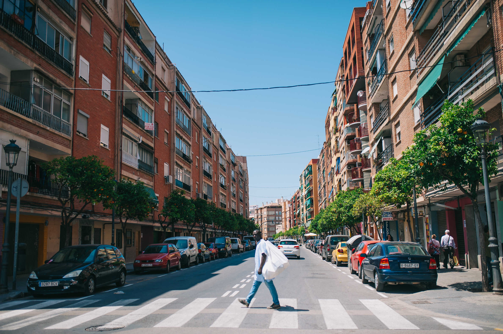
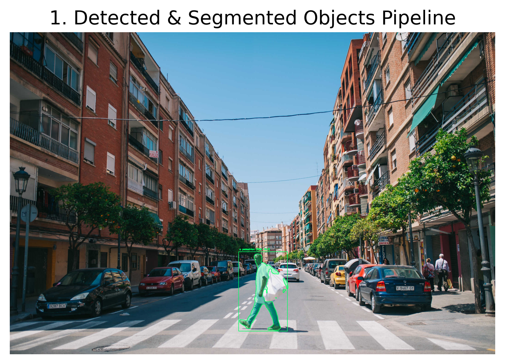
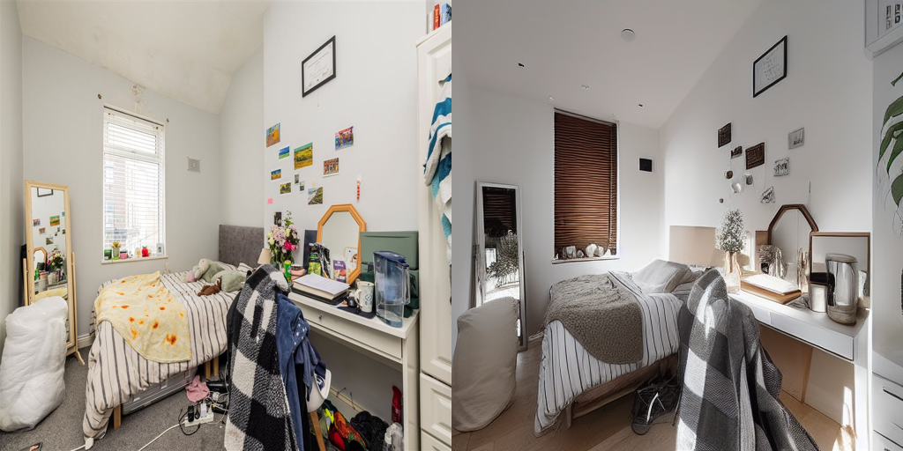
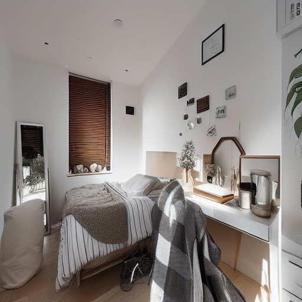

## Overview

[Computer Vision Labs](https://github.com/moza369/computer-vision-labs) is a collection of three practical experiments in computer vision and generative AI. The project combines image preprocessing, pretrained vision models, and diffusion-based generation to solve different tasks with separate workflows.

The labs cover:

1. OCR with image preprocessing
2. Object detection, segmentation, and relative depth estimation
3. AI-powered interior redesign

## 1. OCR and Image Preprocessing

The first lab uses OpenCV and Tesseract OCR to extract text from a noisy image. The workflow improves the input before OCR rather than sending the raw image directly to Tesseract.

### Workflow

- Convert the image to grayscale.
- Reduce noise with filtering.
- Apply thresholding to separate text from the background.
- Use morphology where needed to clean small artifacts.
- Resize and pad the image before OCR.
- Extract text with Tesseract through Python.

<table>
<tr>
<td>
<figure>
  
  <figcaption>Original OCR input image.</figcaption>
</figure>
</td>
<td>
<figure>
  
  <figcaption>Processed OCR image used for text extraction.</figcaption>
</figure>
</td>
</tr>
</table>

This lab shows how OCR quality depends heavily on preprocessing. The result improves after cleaning the image, but text recognition still depends on the clarity of the source image.

**Technologies used:** Python, OpenCV, Tesseract OCR, `pytesseract`.

## 2. Object Detection, Segmentation, and Relative Depth Estimation

The second lab combines three pretrained vision models to analyze a real-world scene:

- **Grounding DINO** for text-prompt object detection
- **Segment Anything (SAM)** for instance segmentation
- **Depth Anything** for relative depth estimation

### Workflow

1. Load a scene image.
2. Run text-prompted detection with Grounding DINO.
3. Use SAM to generate segmentation masks for the detected objects.
4. Estimate relative depth for the scene with Depth Anything.
5. Visualize the outputs together for comparison.

<table>
<tr>
<td>
<figure>
  
  <figcaption>Input scene for detection and segmentation.</figcaption>
</figure>
</td>
<td>
<figure>
  
  <figcaption>Detection and segmentation result.</figcaption>
</figure>
</td>
<td>
<figure>
  
  <figcaption>Estimated relative depth map.</figcaption>
</figure>
</td>
</tr>
</table>

The depth map is a model estimate of relative depth, not calibrated physical distance. It is useful for visualization and scene understanding, but it should not be treated as a metric depth measurement.

**Technologies used:** Python, PyTorch, Grounding DINO, SAM, Depth Anything, Transformers.

## 3. AI-Powered Interior Redesign

The third lab explores image-to-image generation for redesigning a bedroom using Stable Diffusion, Hugging Face Diffusers, and ControlNet.

### Workflow

1. Load the original room image.
2. Extract structural guidance from the room layout.
3. Define prompts for the desired redesign.
4. Generate a new interior using Stable Diffusion through Diffusers.
5. Apply ControlNet to guide the output with the original structure.
6. Compare the original room with the generated redesign.

<table>
<tr>
<td>
<figure>
  
  <figcaption>Original bedroom image.</figcaption>
</figure>
</td>
<td>
<figure>
  
  <figcaption>Before-and-after comparison.</figcaption>
</figure>
</td>
</tr>
</table>

<figure>
  
  <figcaption>Generated bedroom redesign.</figcaption>
</figure>

ControlNet helps preserve the room structure, but it does not guarantee exact preservation of every wall, window, or furniture element. The output is a guided redesign, not a perfect reconstruction.

**Technologies used:** Python, PyTorch, OpenCV, Hugging Face Diffusers, Stable Diffusion, ControlNet.

## Challenges and Limitations

- OCR results depend on the input image quality and the chosen preprocessing steps.
- Detection and segmentation depend on model checkpoints, prompts, and scene composition.
- The depth map is relative and visual, not calibrated in physical units.
- The interior redesign is structurally guided, but the generated image can still alter details from the source room.
- Some of the demonstration images came from Google Images, so original sources and applicable licenses should be checked where possible.

## What I Learned

- How preprocessing choices affect OCR output.
- How to combine object detection and segmentation in one workflow.
- How to interpret relative depth maps without overreading them as real-world measurements.
- How to guide diffusion models with ControlNet for controlled image generation.
- How to combine classical computer vision, pretrained models, and generative AI in a single Python project.

## Image Credits

Some input images used in these educational demonstrations were found through Google Images. Google Images is a search engine, not the original image host. Where possible, original sources and applicable licenses should be checked before reuse. The generated outputs in this project were produced as part of the experiments documented here.

## Repository

The full notebooks and example outputs are available here:

- [View Computer Vision Labs on GitHub](https://github.com/moza369/computer-vision-labs)
