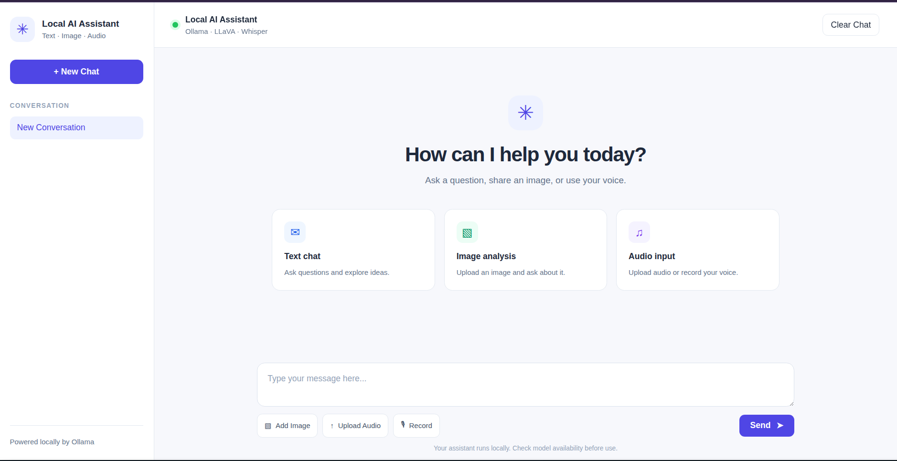
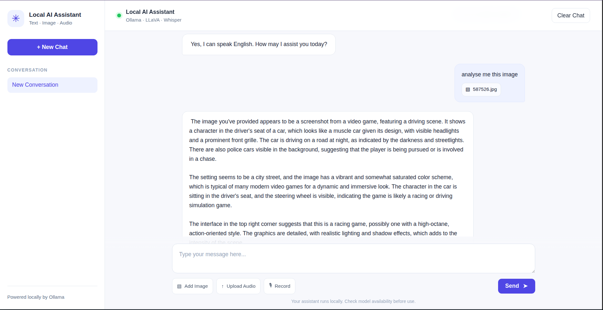

## Overview

[LocalMind AI](https://github.com/moza369/localmind-ai) is a local-first multimodal AI assistant developed as an academic project with a teammate under the supervision of **Anas Charroud**. The application brings text interaction, image analysis, and audio input together in a browser-based interface.

The project explores how a web application can connect users to locally hosted AI models without relying on a remote model API for the core inference workflow. A FastAPI backend serves the interface and coordinates requests, Ollama runs the local vision-language model, and Whisper handles audio transcription.

## Motivation and Objectives

Our objective was to build a practical assistant that could handle more than text prompts while keeping the model runtime local. The project focuses on:

- Providing a simple chat-style web interface.
- Connecting browser requests to local AI services through a Python backend.
- Supporting text conversations with a local language model.
- Sending images to a vision-language model for analysis.
- Transcribing uploaded or recorded audio before passing the resulting text into the assistant workflow.
- Learning how different multimodal inputs require different processing paths.

The project is still under active development. Features listed in the roadmap, such as persistent memory and multiple conversation management, are not presented as implemented functionality.

## Architecture

The application uses a small web architecture with separate processing paths for text, images, and audio:

```text
                         LocalMind AI
                              |
                    Web interface
              HTML · CSS · JavaScript · Jinja2
                              |
                           FastAPI
                    /         |          \
             Text request   Image       Audio
                 |         analysis   transcription
                 |            |          |
                 |            |      OpenAI Whisper
                 |            |          |
                 \____________|__________/
                              |
                           Ollama
                              |
                           LLaVA 7B
                              |
                         AI response
```

FastAPI serves the Jinja2 interface and exposes the backend routes. The frontend sends requests to these routes, while the backend prepares the model input and returns a JSON response for the interface to display.

## Technology Choices

### FastAPI

FastAPI provides the Python web backend, request handling, file upload support, and JSON responses. It also serves the static frontend assets and renders the main Jinja2 template.

### Ollama and LLaVA 7B

Ollama provides the local model runtime. The application calls the `llava:7b` model for text prompts and image-aware requests. Images are read by the backend and passed to Ollama as image bytes alongside the user's message.

### OpenAI Whisper

Whisper is used for audio transcription. The transcription service loads the `base` Whisper model, transcribes a temporary audio file, and returns the extracted text. That text can then be used as the instruction sent to the local assistant.

### Browser technologies

The interface is built with HTML, CSS, JavaScript, and Jinja2 templates. The repository includes a chat layout with attachment previews, removable attachments, and loading indicators.

## Implemented Request Flows

### Text chat

The `POST /api/chat` route accepts a JSON body containing a `message` field. FastAPI validates the request with a Pydantic model, then the backend sends the message to Ollama using the `llava:7b` model.

```json
{
  "message": "Explain what a local multimodal assistant is."
}
```

The response is returned as JSON:

```json
{
  "response": "..."
}
```

### Image analysis

The `POST /api/chat/image` route accepts a form message and an uploaded image. The backend reads the image bytes and includes them in the Ollama message as an image input. This is distinct from audio processing: the image is sent directly to the vision-language model for analysis, rather than being converted into text first.

### Audio transcription and assistant processing

The implemented `POST /api/chat/audio` route accepts optional text, audio, and image form fields. When audio is supplied, the backend:

1. Reads the uploaded audio.
2. Writes it to a temporary file while preserving its extension where available.
3. Passes the temporary path to the Whisper transcription service.
4. Combines the original message with the transcription.
5. Sends the resulting instruction to Ollama.
6. Deletes the temporary file in a `finally` block.

An optional image can also be included in this route and attached to the Ollama message. Audio therefore follows a transcription-first path, while image analysis uses the image input supported by LLaVA.

### Health check

The backend also exposes `GET /api/health`, which returns a simple status response for checking that the application is running.

## Interface

<figure>
  
  <figcaption>LocalMind AI main interface.</figcaption>
</figure>

<figure>
  
  <figcaption>Text chat through the local assistant interface.</figcaption>
</figure>

<figure>
  
  <figcaption>Image analysis workflow.</figcaption>
</figure>

<figure>
  
  <figcaption>Audio input and transcription workflow.</figcaption>
</figure>

## Installation and Execution

The following commands are based on the repository README and its current application entry point.

### Prerequisites

- Python 3.10 or later
- Ollama
- FFmpeg for audio processing
- Enough local storage and memory for the selected models

### Setup

Clone the repository and enter the project directory:

```bash
git clone https://github.com/moza369/localmind-ai.git
cd localmind-ai
```

Create a virtual environment and install the dependencies:

```bash
python3 -m venv .venv
source .venv/bin/activate
pip install -r requirements.txt
```

Install FFmpeg through the operating system's package manager if it is not already available. Then download the model used by the application:

```bash
ollama pull llava:7b
```

Ollama must be running before the FastAPI application handles model requests.

### Run the application

The repository starts the application with Uvicorn:

```bash
uvicorn app:app --reload
```

Open the local interface at:

```text
http://127.0.0.1:8000
```

The development server is intended for local use and should not be exposed directly to untrusted networks.

## Challenges and Limitations

- Local model execution depends on available hardware, memory, storage, and model download time.
- Whisper transcription depends on the input audio and the local environment's audio-processing support.
- The application currently uses a single configured Ollama model, `llava:7b`.
- Uploaded files and local services still require validation and security hardening; local inference alone does not make an application secure.
- Chat persistence and multi-conversation management are not implemented in the current application.
- The repository roadmap includes future work on AI security, prompt-injection evaluation, file validation, error handling, automated tests, and configurable inference.

## Future Improvements

The repository identifies the following planned directions:

- Add persistent chat history and multiple independent conversations.
- Implement inspectable, editable, and deletable long-term memory.
- Improve combined text, image, and audio workflows.
- Add configurable local models and inference settings.
- Improve uploaded-file validation, temporary-file handling, and error management.
- Evaluate prompt injection and malicious instructions in text, images, and audio.
- Add backend, multimodal, and security regression tests.

These items are planned improvements rather than claims about the current implementation.

## What We Learned

This project gave us practical experience integrating several layers of a local AI application:

- Designing a FastAPI backend that serves a browser interface and model-backed JSON endpoints.
- Connecting a web request to Ollama and a local vision-language model.
- Handling image bytes as model input instead of treating every request as text-only.
- Separating audio transcription from image analysis and combining transcription with the user's instruction.
- Managing temporary audio files during a request.
- Recognizing that privacy benefits from local inference still need to be combined with validation, access controls, and broader security testing.

## Source Code

The complete implementation, setup instructions, screenshots, and roadmap are available in the repository:

[View LocalMind AI on GitHub](https://github.com/moza369/localmind-ai)

## Team and Supervision

LocalMind AI was developed as an academic project with a teammate under the supervision of **Anas Charroud**.
